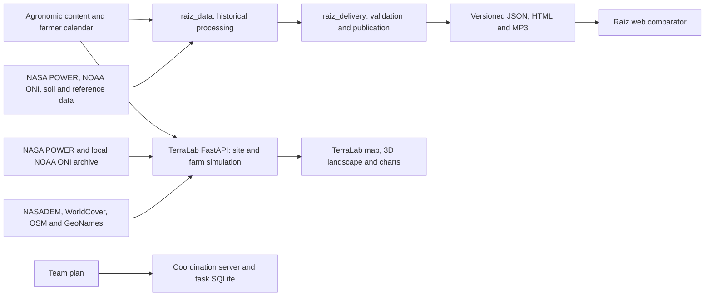

# Raíz — Historical climate evidence for crop-rotation decisions

**NASA Space Apps Challenge 2026 · Field Shift: Adapting Farms with NASA Data · Bolivia**

Raíz helps farmers and agricultural technicians explore crop rotations using historical NASA climate data, explicit soil-water models, and knowledge contributed by a farmer in the Bolivian Altiplano. It combines a web comparator, a geographic and 3D farm workspace, and a pipeline for reproducible datasets, printable summaries, and audio bulletins.

The project asks a practical question: **how would a farming strategy have behaved under the weather recorded in previous seasons?** It presents water requirements, stress, cold exposure, and soil cover so people can examine tradeoffs and make their own decisions.

> **Documentation baseline:** source commit `9917ee0` (live simulation of each farm) — November 15, 2026. This README describes the code and data committed at that revision; subsequent work is outside its scope.

## Contents

- [What is included](#what-is-included)
- [Architecture and repository layout](#architecture-and-repository-layout)
- [Scientific approach and data](#scientific-approach-and-data)
- [Quick start](#quick-start)
- [Data processing and publication](#data-processing-and-publication)
- [API](#api)
- [Configuration and deployment](#configuration-and-deployment)
- [Testing and verification](#testing-and-verification)
- [Interpretation and limitations](#interpretation-and-limitations)
- [Documentation, attribution, and licenses](#documentation-attribution-and-licenses)

## What is included

| Component | Purpose | Implementation |
| --- | --- | --- |
| **Raíz comparator** | Explore published crop-rotation results, historical climate, soil cover, printable sheets, and audio | `beta-frontend/`: React 18, JavaScript, Vite 5 |
| **TerraLab 3D and farm simulation** | Choose a farm on a map, generate its landscape, and simulate a user-defined rotation, soil, and water supply | `simulacion/`: React 19, TypeScript, Vite 8, Three.js, React Three Fiber, MapLibre, Zustand, FastAPI |
| **Scientific data pipeline** | Download source data, run historical scenarios, calculate indicators, and generate verification reports | `raiz-hackaton/raiz_data/`: Python standard library |
| **Delivery and communication pipeline** | Validate datasets, assemble messages and MP3 assets, generate printable HTML, and publish versioned releases | `raiz-hackaton/raiz_delivery/`: Python standard library |
| **Team coordination center** | Maintain the hackathon plan and a shared task board | `raiz-hackaton/server.py`, `dist/`, and a local SQLite database |

### Raíz comparator

The main web app reads an already published package. Its four views share a common scenario selection:

1. **Compare rotations:** nine cases across three sequences, with decision-season indicators and details for the full cycle. The current presentation does not rank cases or select a winner.
2. **Historical climate:** complete November–March seasons, comparisons between periods, sample sizes, variability, charts, and tabular alternatives.
3. **Soil and cover:** soil assumptions, planned monthly cover, and the availability of sensitivity analysis.
4. **Sheet and audio:** scenario-specific text, matching audio when available, a printable sheet, and a separate regional bulletin.

The app also includes text-size settings, motion controls, alerts, a guided tutorial, and seven interface languages: Spanish, Quechua, Aymara, Guaraní, English, Portuguese, and French. Spanish is the reference language; automated translations and synthetic tutorial voices carry review limitations. Approved messages and the farmer's recording retain their original content.

### TerraLab: location, landscape, and a simulation of your farm

The workflow starts with a map: search for a place or enter coordinates, size and position the farm region, confirm it, and save it in the browser. From the farm screen, users can:

- Generate a 3D landscape from NASADEM elevation, ESA WorldCover land cover, and available OpenStreetMap features, with terrain materials, vegetation, lighting, and an explorable camera.
- Run a **live historical simulation** of their own three-season sequence using potato, quinoa, faba bean, or fallow in each position.
- Choose among six soil textures, set effective depth and initial moisture, and select rainfed conditions, unlimited net irrigation, or a well-water volume per irrigated season.
- Inspect charts for water requirements, applied irrigation, stress, historical rainfall, cover, and the cycle's water balance, filtered by period and ENSO phase.

The simulation uses the selected farm's area to convert water depths to volumes: **1 mm over 1 ha = 10 m³**. Farm location and form settings persist locally in the browser. The 3D landscape and the historical water-balance calculation are separate features; rendering the landscape does not simulate crop growth or yield.

## Architecture and repository layout

The repository contains two agricultural application paths and a separate coordination service:



```text
.
├── beta-frontend/
│   ├── src/                    Comparator views, components, translations, and data readers
│   ├── scripts/                Package preparation, integration checks, and language tools
│   └── public/                 Example data, alerts, tutorial audio, and generated packages
├── simulacion/
│   ├── Makefile                Installation, development, data preparation, and quality checks
│   ├── frontend/
│   │   ├── src/                Map, farm form, charts, 3D world, state, and API clients
│   │   ├── asset-pipeline/     Asset download, processing, validation, and catalog generation
│   │   ├── e2e/               Playwright browser tests
│   │   └── public/raiz/       Committed pilot package and audio
│   ├── backend/
│   │   ├── app/api/           Health, geocoding, world, and agricultural endpoints
│   │   ├── app/engine/        FAO-56 balance, package assembly, and live farm simulation
│   │   ├── app/data_sources/  POWER, raster, elevation, land-cover, OSM, and geocoding adapters
│   │   ├── data/power/        Committed pilot evidence and generated site caches
│   │   └── tests/             Backend tests
│   ├── scripts/               Pilot package generation and POWER/P6 checks
│   └── docs/                  Architecture, decisions, assets, progress, and roadmap
├── raiz-hackaton/
│   ├── raiz_data/             Downloads, agronomy, scenarios, reports, alerts, and bulletins
│   ├── raiz_delivery/         Contracts, communications, audio import, sheets, and publication
│   ├── datos/                 Committed scientific JSON and raw source evidence
│   ├── assets/audio/          Versioned audio assets and catalogs
│   ├── contracts/             Data and publication specifications
│   ├── fixtures/              Explicitly labeled synthetic contract examples
│   ├── tests/                 Data, contract, publication, and communication tests
│   ├── dist/                  Coordination center frontend
│   ├── server.py              Coordination HTTP server and task API
│   └── plan-equipo.json       Team plan and acceptance criteria
├── content/                   Agronomy, source register, notebooks, audio, and review records
│   └── p6/                    Preserved P6 agronomic delivery used by TerraLab
└── scripts/                   Shared content checks
```

**Model boundary:** the batch pipeline uses `raiz_data/agro.py` (`raiz-agua-1.0`); TerraLab uses `app/engine/raiz.py` (`fao56-balance-1`). They have different parameters, output schemas, and missing-data rules. Their packages and numerical results must be interpreted within the model that produced them.

## Scientific approach and data

### Pilot and rotation design

The pilot is **Obrajes, Soracachi, Oruro, Bolivia**, at approximately **3,809 m** elevation. Published coordinates are rounded to **−17.83, −67.00**; exact farmer coordinates are not required for the public workflow. The climate represents a regional POWER grid cell, even when a point is located within a farm.

The comparison evaluates three candidate sequences informed by local agronomic content:

| Sequence | Three-season order | Cyclic cases |
| --- | --- | --- |
| A | Potato → quinoa → fallow | A-1, A-2, A-3 |
| B | Potato → quinoa → faba bean | B-1, B-2, B-3 |
| C | Potato → faba bean → fallow | C-1, C-2, C-3 |

Each sequence is evaluated from all three starting positions, producing **nine cases**. These are comparison scenarios; a farmer's crop calendar does not establish that every proposed sequence is an observed or validated practice on the same plot.

The batch package committed in `raiz-hackaton/datos/` contains **72 result records**: nine cases × two periods (1981–2000 and 2001–2025) × four ENSO groups. Published results use rainfed conditions and the `local-obrajes` soil assumption, with six indicators and no ranking. The source catalog also retains a SoilGrids profile; the web publisher exposes only profiles used by the published results.

TerraLab additionally supports fixed-case packages for map locations and a separate live calculation for a custom farm. Its pilot package includes four water scenarios: unlimited net requirement, hypothetical caps of 200 and 100 mm per irrigated season, and rainfed conditions. The custom farm endpoint takes the user's own water inputs.

### Sources and their roles

| Source | Role in this repository |
| --- | --- |
| **NASA POWER** | Daily historical rainfall, temperature, humidity, wind, and radiation. Meteorological records begin in 1981; the committed pilot radiation series begins in 1984. Original responses, units, download metadata, and checksums support reproducibility. |
| **NOAA CPC ONI** | Historical ENSO grouping. The southern pilot uses NDJ; TerraLab uses JJA for its exploratory northern calendar. NOAA provides the index, separately from NASA climate data. |
| **FAO-56 and agronomic literature** | Reference evapotranspiration, crop coefficients, water-balance methods, and documented crop or soil assumptions. |
| **Farmer contribution and P6 content** | Location context, crop calendars, irrigation practices, agronomic thresholds, soil description, and communication material. |
| **SoilGrids / texture assumptions** | Soil estimates and scenario parameters, distinguished from a measured soil profile. |
| **SENAMHI, INE, and reported events** | Context and verification material in the batch pipeline; availability does not establish plot-level validation. |
| **NASADEM, ESA WorldCover, OpenStreetMap, GeoNames** | Elevation, land cover, landscape features, maps, and place search for the geographic workflow. |

The full source inventory is in [`raiz_data/registry.py`](raiz-hackaton/raiz_data/registry.py), with agronomic evidence in the [source and claims register](content/p6/registro_fuentes_afirmaciones.md).

### Historical windows, water balance, and indicators

Calculations use windows of **three consecutive complete agricultural seasons**. The first season determines the ENSO group; the following seasons retain their actual historical weather. Neutral (`Normal`) is between −0.5 and +0.5 ONI, El Niño begins at +0.5, La Niña at −0.5, and strong El Niño at +1.5. Strong El Niño is a subset of El Niño, so those groups overlap. This seasonal classification does not implement the full persistence rule for an official ENSO event declaration.

Both model implementations use a daily soil-water balance to relate rainfall, runoff, infiltration, evapotranspiration, irrigation, drainage, and storage. Indicators distinguish the **decision season** from the **full three-season cycle** and include:

- Net irrigation requirement and, where supported, the amount applied under the selected water limit.
- Water-stress days and water deficit.
- Exposure to crop-specific cold thresholds; the batch comparator reports flowering exposure.
- Planned soil cover and bare-soil exposure to rain and wind.
- Sample sizes, missing-data explanations, and model-specific balance diagnostics or variability.

TerraLab irrigates potato and faba bean according to the P6 crop definitions; quinoa remains rainfed. Well water is interpreted as a uniform **net** irrigation volume, without conveyance or application losses. Its northern calendar shifts the southern calendar by six months and is an exploratory assumption.

The archived **“4 of 5”** finding describes strong-El-Niño pilot seasons with November–March rainfall below the mean of Neutral seasons. It is a historical frequency with a five-season sample. The [reproduction result](simulacion/backend/data/power/obrajes/2026-11-14/resultado_4de5.json) and [notebook](content/p6/prueba_4de5_obrajes.ipynb) preserve its method and evidence; it is not a probability for the next season.

## Quick start

Run commands from the indicated component directory. This monorepo has separate frontend installations and no shared root `npm install` command.

### Requirements

| Tool | Raíz comparator and batch tools | TerraLab |
| --- | --- | --- |
| Node.js | 18+ for the comparator | 24+ |
| Python | 3.10+ for data and publication commands | 3.12+ |
| npm | Required for the comparator | Required; component instructions specify 10+ |
| GNU Make | Optional | Used by the commands below |
| Browser | A modern browser with JavaScript and audio support | WebGL 2 for the 3D landscape |

For the entire repository, use Node.js 24+ and Python 3.12+. Data downloads and 3D asset preparation require internet access. Playing existing MP3 files does not require installing a speech-synthesis environment.

### 1. Open the Raíz comparator

From the repository root:

```bash
cd beta-frontend
npm ci
npm run dev -- --port 5175 --strictPort
```

Open **http://localhost:5175/?fuente=paquete**. The startup script validates and publishes the local `raiz-hackaton/datos/` package into `public/paquete/`. If real inputs are absent, it uses an explicitly labeled fixture. In development, a preparation failure is reported and the previous publication may remain available.

The port is explicit because both frontends otherwise default to 5173. For a synthetic UI demonstration, open `?fuente=ejemplo`. Views can be addressed with `?vista=rotaciones`, `clima`, `suelo`, or `ficha`.

### 2. Start TerraLab and its API

In another terminal, from the repository root:

```bash
cd simulacion
make install
make dev
```

Open **http://localhost:5173**. API health is available at **http://127.0.0.1:8000/api/health**, and interactive API documentation at **http://127.0.0.1:8000/api/docs** in development. `Ctrl+C` stops both development servers.

This is enough to try location selection by coordinates and the farm simulation. The first simulation for an uncached location downloads its historical POWER series; later calculations reuse that climate data.

For place-name search and the complete 3D experience, prepare the additional resources from `simulacion/`:

```bash
make assets       # Download, verify, and process the 3D asset library; several hundred MB
make geodata      # Build the local GeoNames search database
make worlddata    # Cache elevation, land cover, and OSM for the Cochabamba demo region
```

`make worlddata` prepares the **Cochabamba demonstration region**, not every map location or the Obrajes climate archive. Other regions retrieve terrain data on demand. OSM features outside cached snapshots require a configured Overpass endpoint.

### 3. Start the optional coordination center

From the repository root:

```bash
cd raiz-hackaton
python3 server.py --host 127.0.0.1 --port 8787
```

Open **http://127.0.0.1:8787**. This service serves the team dashboard and `/api/tasks`; it creates `team.sqlite3` locally. It has no user authentication. The database belongs to team coordination and is separate from agricultural results and TerraLab's API.

On Windows, use `python` instead of `python3` if needed, and `npm.cmd` if PowerShell blocks `npm.ps1`. The TerraLab Makefile uses Bash and Unix virtual-environment paths; run it through WSL or adapt the commands for a native Windows setup.

## Data processing and publication

### Rebuild the batch dataset

From `raiz-hackaton/`:

```bash
python3 -m raiz_data fuentes       # Print the source inventory
python3 -m raiz_data procesar      # Reprocess local raw evidence without downloading
python3 -m raiz_data informe       # Regenerate the results report
```

To fetch source updates before processing, run `python3 -m raiz_data todo`; use `python3 -m raiz_data descargar --refresh` to request a fresh download. Processing regenerates scientific outputs, reports, and the local agricultural dataset `datos/raiz_oruro.sqlite3`. Some generated JSON and report files are tracked, so inspect their diffs when intentionally rebuilding data.

### Prepare the web publication

From `beta-frontend/`:

```bash
npm run paquete           # Build and publish the local data/audio package
npm run test:integration  # Check package integrity and the frontend contract
npm run build             # Prepare the package and compile the app into dist/
npm run preview           # Preview the compiled app on port 4173
```

The preparer uses `raiz_data.web` to add climate and cover views without recalculating scientific KPIs. `raiz_delivery` checks references, units, dates, source originals, hashes, and audio/text consistency. Releases live under `releases/<build_id>/`; `current.json` activates a complete release atomically.

For direct package inspection and publication, from `raiz-hackaton/`:

```bash
python3 -m raiz_delivery analyze --input datos
python3 -m raiz_delivery build --input datos --output build/paquete
python3 -m raiz_delivery check --package build/paquete
python3 -m raiz_delivery publish --package build/paquete --site-root build/sitio-estatico
python3 -m raiz_delivery serve --site-root build/sitio-estatico --port 8790
```

That minimal build does not import MP3 assets. Use `--audio-assets <catalog-directory>` and, where needed, `--editorial <file>` when constructing a package with matching reviewed communication assets. The `--production` option on build, check, publish, and activate applies additional publication requirements. See the [executable contract](raiz-hackaton/contracts/dev2-v31.md) and [audio workflow](raiz-hackaton/docs/dev2/AUDIO.md).

### Rebuild TerraLab's pilot package

From `simulacion/`:

```bash
make raiz-data
```

This uses `content/p6/` and the committed POWER evidence in `backend/data/power/obrajes/2026-11-14/`, then writes the TerraLab pilot package into `frontend/public/raiz/`. It does not query providers or run the CHIRPS notebook. It is a separate output from the comparator's `public/paquete/` publication.

### Alerts, bulletins, and voice assets

The data CLI includes external-event review (FIRMS, USGS, GDACS), manually approved alert workflows, weekly or manual bulletins, and app notices derived from historical ENSO and recent rainfall. Discover the supported commands with:

```bash
cd raiz-hackaton
python3 -m raiz_data --help
python3 -m raiz_data alertas --help
python3 -m raiz_data boletin --help
```

`python3 -m raiz_data alarmas --publicar` rebuilds and copies app notices into the available frontend targets. This is a local file-publication step. MP3 generation is a separate batch operation: Meta MMS uses its own optional environment; Spanish and English tutorial generation uses ElevenLabs and an `ELEVENLABS_API_KEY` configured outside version control. Existing audios are served directly, with no TTS call during ordinary navigation.

## API

TerraLab serves its API on port **8000** under `/api`:

| Method | Endpoint | Purpose |
| --- | --- | --- |
| GET | `/api/health` | Service status and version |
| GET | `/api/geocoding/info` | Search provider and availability |
| GET | `/api/geocoding/search?q=...&limit=...` | Place-name search |
| GET | `/api/world/datasets` | Geographic data provenance and available sources |
| GET | `/api/world/elevation` | NASADEM grid for a bounding box |
| GET | `/api/world/landcover` | ESA WorldCover grid for a bounding box |
| GET | `/api/world/features` | Available OpenStreetMap features for a bounding box |
| GET | `/api/raiz/sitio?lat=...&lon=...` | Generate or read a cached fixed-case package for a map location |
| POST | `/api/raiz/granja` | Simulate the submitted farm, rotation, soil, and water supply |

World-data requests accept `south`, `west`, `north`, and `east`; raster endpoints also accept `maxSize`. See `/api/docs` for constraints and response schemas.

Example live farm request:

```bash
curl --request POST http://127.0.0.1:8000/api/raiz/granja \
  --header 'Content-Type: application/json' \
  --data '{
    "lat": -17.83,
    "lon": -67.00,
    "area_ha": 1.5,
    "rotation": ["papa", "quinua", "descanso"],
    "texture": "franco_arcillo_arenoso",
    "depth_m": 0.6,
    "initial": "medio",
    "water": "pozo",
    "well_m3_per_campaign": 3000
  }'
```

The response uses schema `terralab-granja-1` and contains farm inputs, climate-cell metadata, historical windows, per-season and cycle indicators, source information, and limitations. Invalid inputs or insufficient complete history return `422`; a POWER retrieval failure returns `502`.

POWER requests round map coordinates to **0.1°**, store the original response and download metadata, and verify its checksum on reuse. Climate and ET0 are reused across farm calculations; fixed-case site packages are also cached on disk using a code digest.

## Configuration and deployment

Copy the component examples when customizing a local setup:

```bash
cp simulacion/backend/.env.example simulacion/backend/.env
cp simulacion/frontend/.env.example simulacion/frontend/.env.local
cp beta-frontend/.env.example beta-frontend/.env.local
```

| Variable | Component | Purpose |
| --- | --- | --- |
| `VITE_API_BASE_URL` | TerraLab frontend | Defaults to `http://127.0.0.1:8000`; `/` uses the page's origin |
| `VITE_RAIZ_COMPARADOR_URL` | TerraLab frontend | Comparator link; defaults to local port 5175 in development |
| `VITE_RAIZ_SIMULACION_URL` | Comparator | TerraLab link; defaults to local port 5173 in development and must be configured to show the link in a production build |
| `VITE_BASEMAP_STYLE_URL`, `VITE_SATELLITE_TILES_URL` | TerraLab frontend | Map style and satellite imagery providers |
| `TERRALAB_ENVIRONMENT` | TerraLab backend | `development`, `test`, or `production` |
| `TERRALAB_CORS_ORIGINS` | TerraLab backend | Explicit development origins, separated by commas |
| `TERRALAB_GEOCODER`, `TERRALAB_GAZETTEER_PATH` | TerraLab backend | Local GeoNames search, optional Nominatim, or disabled search |
| `TERRALAB_WORLD_DATA_DIR`, `TERRALAB_WORLD_OFFLINE` | TerraLab backend | Geographic cache location and cached-data-only mode |
| `TERRALAB_OVERPASS_URL`, `TERRALAB_OVERPASS_USER_AGENT` | TerraLab backend | Optional live OSM retrieval outside cached regions |
| `TERRALAB_RAIZ_CACHE_DIR`, `TERRALAB_RAIZ_OFFLINE` | TerraLab backend | POWER/site cache location and cached-climate-only mode |
| `TERRALAB_RAIZ_CONTENT_DIR`, `TERRALAB_RAIZ_ONI_PATH` | TerraLab backend | Agronomic content and local NOAA ONI archive |

`VITE_*` values are exposed to the browser and are resolved when Vite builds the app. Store provider credentials in the appropriate private environment, never in frontend variables.

For the comparator's compiled tunnel preview, run `npm run paquete` followed by `npm run publicar` from `beta-frontend/`; it serves on **5175**. The configured host is `front-nasa.los5furiosos.cloud`. TerraLab's Vite configuration allows `simulacion-nasa.los5furiosos.cloud`; set `VITE_API_BASE_URL=/` to route `/api` through its development proxy to port 8000. Both TerraLab servers must run for that setup.

For production, build each frontend separately. The comparator is a static app; TerraLab additionally requires FastAPI and a reverse proxy that serves `/api` on the same origin. Backend CORS and interactive API documentation are disabled in `production`. Vite's development proxy is not included in the built static files.

The comparator reads prepared assets without contacting NASA, NOAA, or a TTS provider during interaction. TerraLab can contact POWER on the first request for an uncached location and geographic services for uncached regions. Offline flags cover their respective caches; they do not make externally hosted map tiles available offline or provide a PWA.

## Testing and verification

| Working directory | Command | Coverage |
| --- | --- | --- |
| `beta-frontend/` | `npm test` | Frontend domain, translation, ranking utilities, and tutorial logic |
| `beta-frontend/` | `npm run test:integration` | Published package integrity and data contract |
| `beta-frontend/` | `npm run build` | Package preparation and production compilation |
| `raiz-hackaton/` | `python3 -m unittest discover -s tests -v` | Data/model checks, contracts, communications, audio metadata, and publication |
| `raiz-hackaton/` | `python3 scripts/check_dev2.py` | Reproducible fixture checks and local build/check/publish workflow |
| `simulacion/` | `make check` | Frontend/backend lint, format checks, types, unit tests, and frontend build |
| `simulacion/` | `make install-browsers` then `make test-e2e` | Playwright browser tests; asset-dependent cases require `make assets` |
| Repository root | `python3 scripts/check_p6.py content/p6` | P6 content and source-register checks |

TerraLab also provides `make test`, `make lint`, `make typecheck`, `make assets-verify`, and `make help`. The backend suite includes farm-input validation, site-package generation, and model balance checks. Passing structural or numerical tests establishes the tested behavior; agronomic review and field calibration remain separate evidence.

Dependencies, generated frontend packages, 3D assets, site/world caches, and local SQLite databases are excluded from version control as configured in the component `.gitignore` files. Selected raw scientific evidence and delivered MP3 assets are intentionally committed.

## Interpretation and limitations

- **Historical analysis:** the project does not forecast the next season, recommend a crop, or calculate yield, income, calibrated erosion, or hail damage. Externally sourced outlooks in archived content must be read with their original dates.
- **Regional resolution:** POWER meteorology covers approximately 0.5° × 0.625°; radiation has a different grid. Plot coordinates and a detailed 3D landscape do not create plot-scale weather observations.
- **Small and overlapping samples:** three-season windows share years. ENSO groups can overlap, and five strong-El-Niño seasons provide limited evidence. Where fewer than three windows are available, the interfaces avoid conclusions or ranking.
- **Model assumptions:** soil storage, rooting depth, runoff, crop stages, cover, and cold thresholds include documented assumptions. Texture estimates are not soil measurements; air-temperature exposure is not observed crop injury.
- **Model-specific completeness:** the batch pipeline supports an ET0 fallback where early radiation is missing; TerraLab requires complete ET0 over its balance windows and excludes incomplete windows. Availability therefore differs between outputs.
- **Sensitivity:** the committed comparator results declare `not_evaluated`. TerraLab's low/high soil runs explore parameter assumptions; they are not an independent rainfall source, a confidence interval, or total uncertainty. CHIRPS and other planned datasets must not be presented as completed validation.
- **Geographic transfer:** live TerraLab requests support locations beyond the pilot, but crop parameters and calendars originate in Oruro. Other locations, especially the shifted northern calendar, are exploratory.
- **Audio and language review:** the farmer's Quechua bulletin has its own consent and review records. Synthetic tutorials, translated interfaces, and other generated messages have distinct review states. A radio-ready file does not establish that a station broadcast it.
- **Operational scope:** there are no agricultural accounts, cloud-synced farms, or complete offline synchronization. Farm settings are browser-local; the shared task database belongs to the coordination center.

## Documentation, attribution, and licenses

| Reference | Content |
| --- | --- |
| [Comparator README](beta-frontend/README.md) and [design notes](beta-frontend/DESIGN.md) | Component setup and interface design |
| [Interface language workflow](beta-frontend/src/i18n/LEEME.md) | Dictionaries, translation conventions, and tutorial audio |
| [TerraLab README](simulacion/README.md) | Component installation and resource preparation |
| [Architecture](simulacion/docs/ARCHITECTURE.md), [decisions](simulacion/docs/DECISIONS.md), and [roadmap](simulacion/docs/ROADMAP.md) | Technical structure and milestone history |
| [Asset documentation](simulacion/docs/ASSETS.md) | 3D asset sources, processing, attribution, and licenses |
| [Data methodology](raiz-hackaton/docs/datos/METODOLOGIA.md) and [results report](raiz-hackaton/docs/datos/RESULTADOS.md) | Batch model, source handling, verification, and reported results |
| [Executable publication contract](raiz-hackaton/contracts/dev2-v31.md) | Schemas, modes, references, validation, and missing-data rules |
| [P6 delivery](content/p6/README.md) and [sources, licenses, and AI declaration](content/p6/P6-6_fuentes_licencias_IA.md) | Agronomic provenance and editorial material |
| [Bulletin audio and reviews](content/audio/LEEME.md) | Spanish and farmer-recorded Quechua assets, attribution, and review evidence |

Some component documents retain earlier milestone descriptions, including planned work that has since been implemented. Use the baseline stated above, the committed packages, and their model versions when interpreting those records.

NASA POWER, NASADEM, NOAA CPC, FAO-56, ISRIC, ESA, OpenStreetMap contributors, GeoNames, the cited Bolivian institutions, and the contributing farmer are credited for their respective data, methods, and knowledge. Product provenance and applicable terms are recorded with the source and asset inventories. This is an independent hackathon project, not an official NASA product.

AI assistants helped with literature discovery, drafting, translation, implementation, and debugging. Numerical outputs are computed from source data and explicit model inputs; AI assistance does not establish independent reproduction or agronomic approval of every result. The historical “4 of 5” reproduction and each communication asset have their own evidence and review scope.

The repository has **no top-level code license file at this revision**. Do not infer a code redistribution license from the availability of the source or the licenses of its dependencies. Third-party data, fonts, models, and audio retain their own terms: MMS voice assets carry CC BY-NC 4.0 attribution requirements, map/geographic sources include ODbL and CC BY licenses, and bundled fonts include their license files. Consult the inventories above before redistributing an asset or reusing it commercially.
